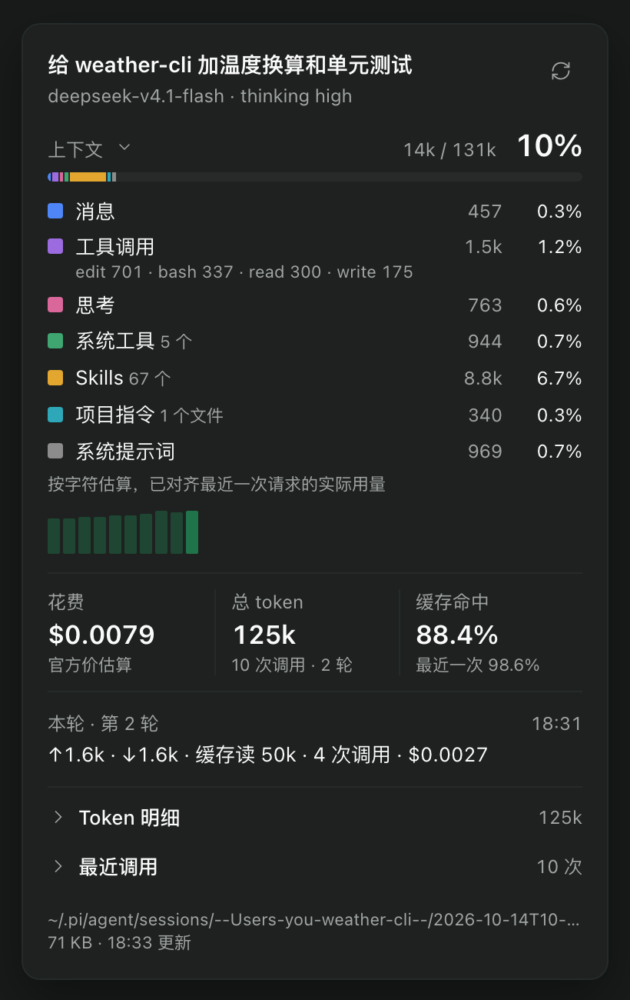

# Pi 用量（paseo-pi-usage）

Paseo 插件，在 Pi 会话的输入框上显示整个会话用了多少 token、花了多少钱，点开能看上下文都被什么占着。相当于 Pi 终端底部状态栏那一行，搬到了 Paseo 里。



截图来自一个示例项目的会话，不含真实数据。

## 怎么用

**输入框上的小标签**：每个 Pi agent 的输入框上方多一个标签，例如 `1.7M · $0.061`，表示整个会话的总 token 和花费，实时更新。鼠标悬停能看到输入、输出、缓存读的拆分和缓存命中率。

**点开的弹窗**（窄屏上是底部弹层），从上到下：

- 会话标题、模型、thinking 等级，右上角刷新。
- 上下文：已用 / 窗口大小和百分比，彩色进度条按类别分段。下面列出各类占了多少：消息、工具调用（附占用最多的几个工具）、思考、MCP 工具、系统工具、Skills、项目指令、系统提示词。再下面是最近 40 次调用的上下文走势小图，能看出什么时候压缩过。
- 三个关键数：花费、总 token（调用次数与轮次）、缓存命中率。
- 本轮：最新一条用户消息之后的输入、输出、缓存读、调用次数和花费。
- 可展开：Token 明细、按模型拆分（用过不止一个模型时出现）、最近调用逐条明细。
- 页脚：会话文件路径和大小。

## 数字怎么来的

- 读的是 Pi 自己的会话文件（`~/.pi/agent/sessions/` 下的 JSONL），所以插件安装之前的历史也算在内。只读新增的部分，不会反复全量解析。
- 累计口径和 Pi 状态栏一致：所有模型调用、带用量的工具结果、压缩和分支摘要都算。压缩之后、下一次调用之前，上下文显示为 `?`，和 Pi 一样。
- **花费**：中转和订阅渠道写进会话文件的花费常常是 0。插件内置一份官方 API 价表（`shared/pricing.ts`），模型在表里就按官方价估算，不在就用 Pi 记账的值。小标签和弹窗用同一个口径。估算不含阶梯价和折扣，会和真实账单有出入。
- **上下文构成**：Pi 1.2 起会把系统提示词和工具声明写进会话文件，插件据此按类别估算（字符数 / 4，中日韩字符 1 字 1 token），再对齐最近一次请求的真实用量。Pi 1.2 之前的会话只显示总进度条，没有构成。

## 限制

- 只统计 provider 为 `pi` 的 agent。
- 会话被回退或分叉后，分支上的重复记录会像 Pi 一样一并计入。
- 价表是静态的，厂商调价后需要手动改 `shared/pricing.ts`。未收录的模型估为 $0，弹窗里会注明。
- 上下文窗口大小取自 Paseo 记录的值，拿不到时读 Pi 的模型配置，再拿不到就显示 `?`。

## 开发

```bash
npm install
npm run test
npm run typecheck
paseo plugin install /absolute/path/to/paseo-pi-usage
paseo plugin ls
```

改完源码先测试和类型检查，再 `paseo plugin reload paseo-pi-usage`，不需要重启 daemon。异常时看 `paseo plugin logs paseo-pi-usage`。

```text
client/pills.ts          输入框标签：每 2.5 秒批量刷新，安静的 agent 只在状态变化时重读
client/panel.tsx         弹窗
server/usageService.ts   定位会话文件、汇总快照和弹窗数据
server/sessionFile.ts    增量解析会话 JSONL
server/contextLedger.ts  回放系统提示词与工具声明，估算上下文构成
server/resolve.ts        从 Paseo 的 agent 记录找到会话文件和上下文窗口
shared/pricing.ts        官方价表
shared/format.ts         数字和花费的格式化
```
